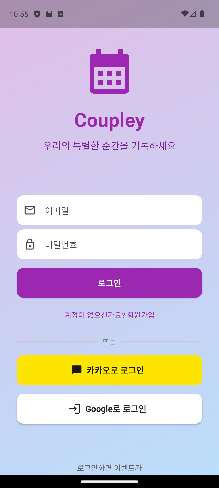
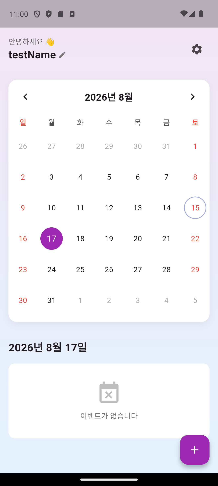
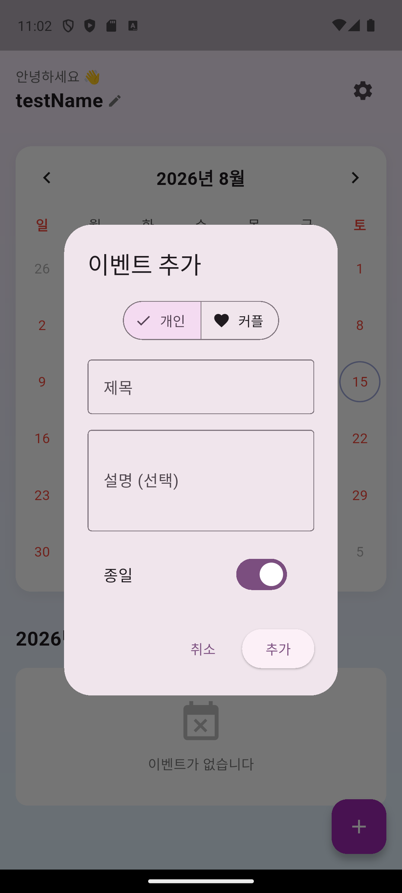
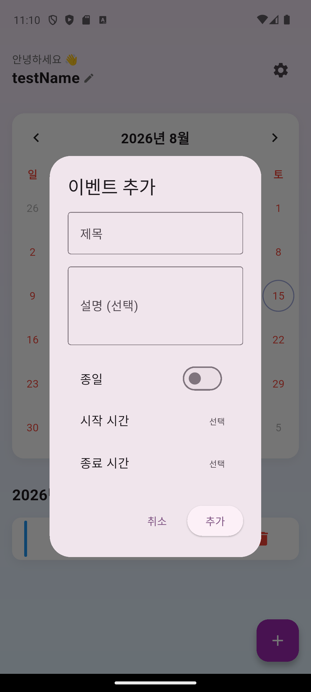
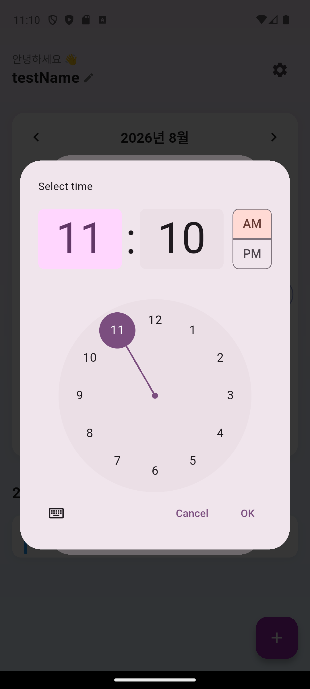
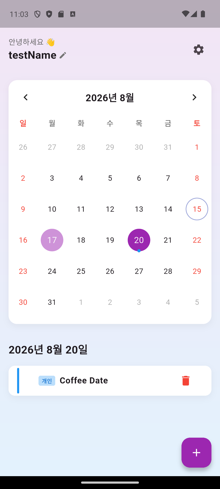
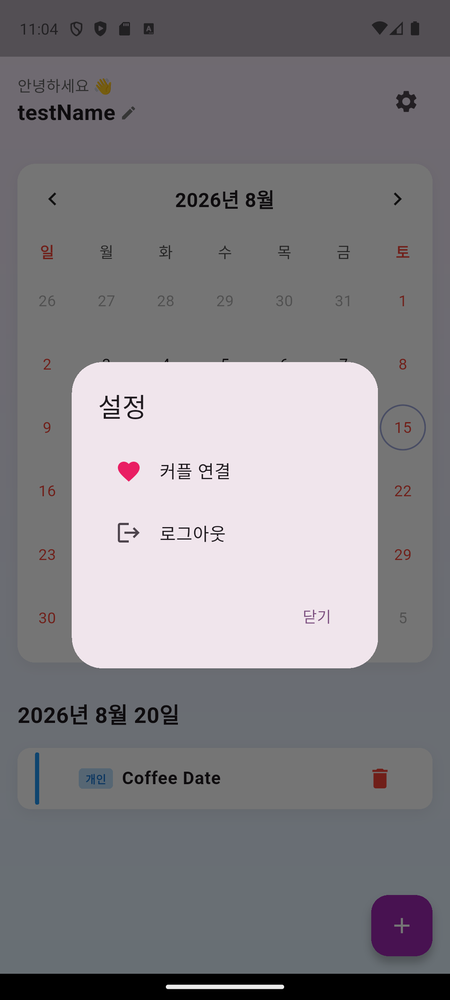
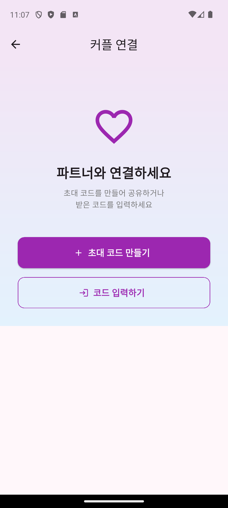
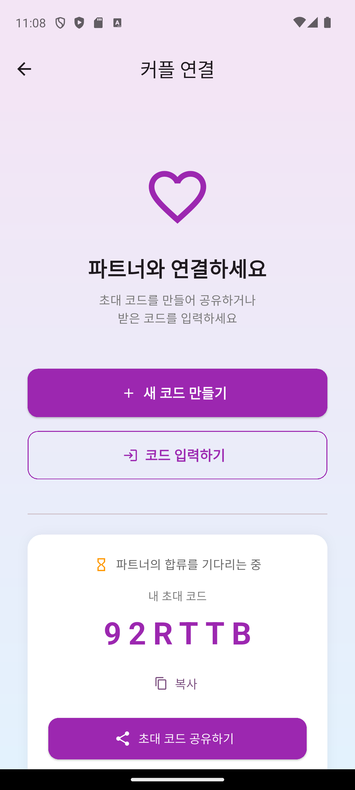
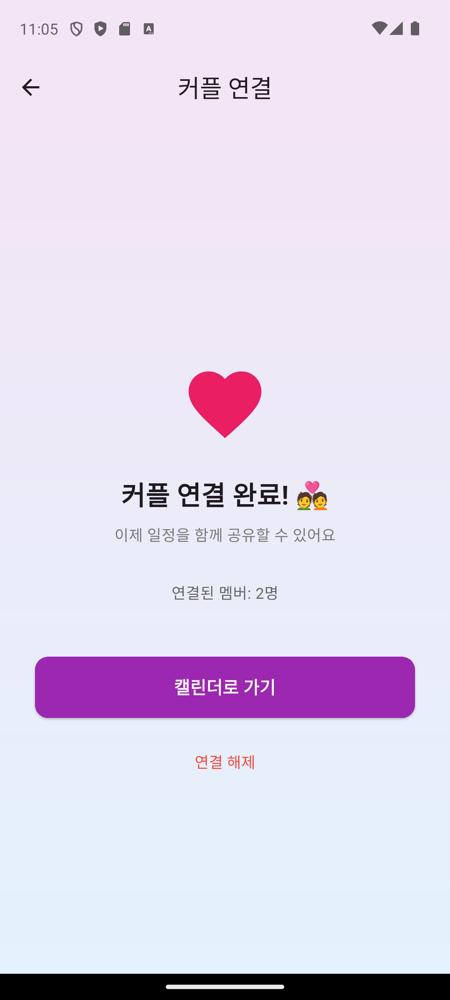

# Coupley 기능·기획 정리

> 실제 에뮬레이터(Pixel 7, Android)에서 앱을 실행하며 화면을 캡처하고 확인한 내용을 바탕으로 정리한 문서입니다.
> 코드 레벨 구현 세부사항은 [`HANDOFF.md`](../HANDOFF.md), 기술 스택/아키텍처는 [`README.md`](../README.md)를 참고하세요.

<br>

## 1. 기획 의도

연인끼리 약속·기념일·데이트 일정을 메신저로 따로 주고받는 번거로움을 없애기 위한 **커플 전용 실시간 공유 캘린더**.

- 한 사람이 일정을 추가하면 상대방 화면에 **실시간으로 반영**
- **개인 일정**과 **커플 일정**을 색상으로 구분해 한 캘린더에서 함께 확인
- 오프라인에서도 일정 추가가 가능하고, 네트워크 복구 시 자동 동기화 (로컬 우선 + Firebase를 진실의 원천으로 삼는 단방향 동기화 구조)
- 커플 일정이 추가/수정/삭제되면 **FCM 푸시 알림**으로 상대에게 즉시 알림

<br>

## 2. 핵심 사용자 플로우

```
로그인/회원가입
   │
   ▼
(최초 1회) 커플 연결 — 초대 코드 생성·공유 또는 입력
   │
   ▼
캘린더 홈 — 날짜 선택 → 일정 목록 확인
   │
   ▼
일정 추가(+) — 개인/커플 구분, 제목·설명·종일 또는 시작·종료 시간 입력
   │
   ▼
저장 즉시 Firebase 반영 → 실시간 리스너로 상대 화면/내 로컬DB(Drift) 갱신 → (커플 일정이면) 상대에게 FCM 푸시
```

<br>

## 3. 화면별 기능 정리

### 3-1. 로그인
이메일/비밀번호, 카카오, Google 로그인을 지원합니다. 이메일 회원가입 시 랜덤 닉네임이 자동 생성됩니다.



<br>

### 3-2. 캘린더 홈
- 상단: 인사말 + 닉네임(연필 아이콘으로 바로 수정 가능) + 설정 버튼
- 월간 캘린더: 일/토요일 빨간색 표시, 오늘 날짜는 채워진 원, 선택한 날짜는 테두리 원으로 구분
- 하단: 선택한 날짜의 일정 리스트 (없으면 빈 상태 안내)
- 우측 하단 `+` 버튼으로 일정 추가



<br>

### 3-3. 일정 추가
`+` 버튼을 누르면 다이얼로그가 뜹니다. 커플 연결이 되어 있으면 **개인/커플** 선택 토글이 함께 표시되고(연결 안 된 상태에서는 개인 일정만), 제목·설명(선택)·종일 여부를 입력합니다.



**종일을 끄면** 시작 시간/종료 시간 입력 필드가 나타나고,



필드를 누르면 Flutter 기본 Material 시간 선택기(다이얼 방식, 숫자 직접 입력 모드 전환 가능)가 열립니다.



추가하면 캘린더의 해당 날짜에 점(dot) 마커가 생기고, 하단 리스트에 색상 바 + "개인"/"커플" 뱃지 + 제목 + 삭제 아이콘이 표시됩니다. (개인=파랑 계열, 커플=핑크 계열 — README 기준)



<br>

### 3-4. 설정
톱니바퀴 아이콘을 누르면 뜨는 다이얼로그. **커플 연결**과 **로그아웃** 메뉴를 제공합니다.



<br>

### 3-5. 커플 연결
- **연결 안 된 상태**: "파트너와 연결하세요" 안내와 함께 `초대 코드 만들기` / `코드 입력하기` 버튼 표시

  

- **초대 코드 생성**: 6자리 영숫자 코드(예: `92RTTB`)가 발급되고, 복사 버튼과 `share_plus` 기반 공유 버튼(카카오톡 등)을 제공. 파트너가 코드를 입력할 때까지 "파트너의 합류를 기다리는 중" 상태 유지

  

- **연결된 상태**: 연결된 멤버 수(2명)와 함께 완료 화면 표시. "연결 해제" 시 확인 다이얼로그가 뜨고("함께 공유한 모든 커플 일정이 삭제되며, 되돌릴 수 없음" 경고), 확인하면 다시 미연결 상태로 돌아감

  

<br>

## 4. 검증된 주요 기능 요약

| 기능 | 확인 여부 | 비고 |
|---|:---:|---|
| 이메일 로그인 | ✅ | 실제 테스트 계정으로 로그인 확인 |
| 캘린더 UI (한글, 요일/공휴일 색상) | ✅ | |
| 일정 추가 (개인) | ✅ | 종일 일정으로 실제 추가·리스트 반영 확인 |
| 종일 ↔ 시간 지정 전환 | ✅ | 토글 끄면 시작/종료 시간 필드 노출 |
| 시간 선택 다이얼로그 | ✅ | Material TimePicker |
| 설정 → 커플 연결/로그아웃 메뉴 | ✅ | |
| 커플 연결 해제 (확인 다이얼로그) | ✅ | 파괴적 동작 — 확인 문구 존재 |
| 초대 코드 생성 + 공유 | ✅ | 6자리 코드 발급 확인 |
| 커플 일정(핑크)/개인 일정(파랑) 색상 구분 | 미검증 | 파트너 계정 미보유로 커플 일정 등록까지는 미확인 |
| FCM 푸시 알림 | 미검증 | 2대 기기(파트너 포함) 필요, 이번 세션에서는 코드/Cloud Functions만 확인 |
| 오프라인 우선 동작 | 미검증 | 네트워크 차단 테스트 미실시 |

<br>

## 5. 향후 계획 (미완료 항목)

`HANDOFF.md`의 "다음 구현할 기능" 목록 기준 발췌:

- 기념일 D-day 표시 (커플 기준일 설정)
- 일정 반복 기능 (매주/매월/매년)
- 커플 프로필 사진 업로드 (Firebase Storage)
- 앱 아이콘/스플래시 이미지 커스터마이즈 (현재는 Flutter 기본 아이콘 상태)
- Android 릴리즈 서명 키스토어 구성, iOS Apple 로그인 인증서 설정
- 단위/위젯 테스트 추가

<br>

---

*이 문서는 2026-08-17 세션에서 `flutter build apk` → 에뮬레이터 설치 → 실제 조작을 통해 캡처한 스크린샷을 근거로 작성되었습니다. 화면 문구나 동작은 이후 커밋에서 바뀔 수 있습니다.*
