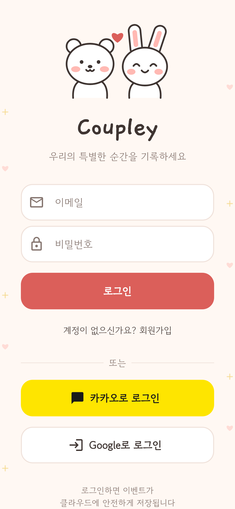
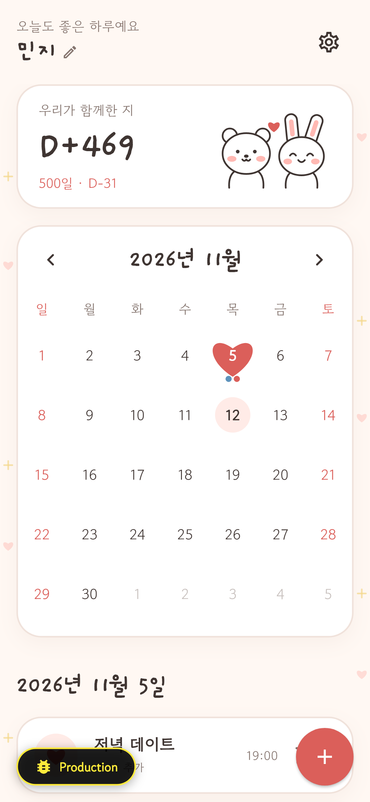
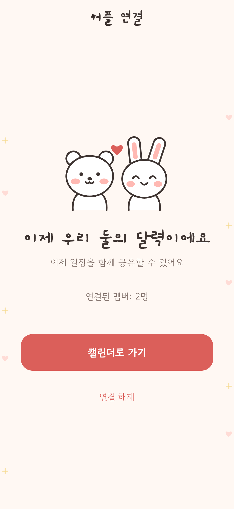

# Coupley 소개

> 둘이 함께 쓰는 커플 공유 캘린더

 

## 어떤 앱인가요

Coupley는 연인이 하나의 캘린더를 함께 쓰는 Flutter 앱입니다. 약속이나 데이트, 기념일 일정을 메신저로 주고받다 보면 금방 대화에 묻힙니다. 이 불편을 줄이려고 만들었습니다.

한 사람이 일정을 추가하면 상대방 캘린더에 바로 나타나고, 상대에게 푸시 알림도 갑니다. 개인 일정과 커플 일정은 한 화면에서 색으로 나눠 보여 줍니다. 그래서 각자의 하루와 둘이 함께하는 날을 같이 확인할 수 있습니다.

 

## 이렇게 사용합니다

1. **로그인** – 이메일, 카카오, Google 계정으로 시작합니다. 이메일로 가입하면 닉네임이 자동으로 만들어집니다.
2. **커플 연결** – 한 사람이 6자리 초대 코드를 만들어 카카오톡 등으로 보내고, 다른 사람이 그 코드를 입력하면 연결됩니다.
3. **일정 추가** – `+` 버튼을 눌러 개인 일정과 커플 일정 중 하나를 고르고, 제목·설명·시간(종일 또는 시작·종료 시간)을 입력합니다.
4. **함께 보기** – 커플 일정은 상대방 화면에 실시간으로 나타나고, 누가 추가했는지도 표시됩니다.

 

## 주요 기능

| 기능 | 내용 |
|---|---|
| 커플 연결 | 6자리 초대 코드 생성·공유·입력, 연결 해제 |
| 일정 관리 | 추가·수정·삭제, 종일/시간 지정, 설명 입력 |
| 개인/커플 구분 | 개인 일정은 파랑, 커플 일정은 핑크로 표시 |
| 실시간 공유 | 한쪽이 바꾼 일정이 상대 화면에 즉시 반영 |
| 작성자 표시 | 커플 일정에 "나" 또는 상대 닉네임 표시 |
| 푸시 알림 | 커플 일정이 추가·수정·삭제되면 상대에게 알림 |
| 오프라인 사용 | 네트워크가 없어도 일정을 추가할 수 있고, 연결되면 자동 동기화 |
| 한국형 캘린더 | 한글 요일, 주말·공휴일 색상 표시 |
| 함께한 날 | 홈 상단에 연결한 날부터 센 D+N 표시 |

 

## 디자인

> 2026년 11월 디자인 개편 내용입니다(`design/cute-redesign` 브랜치).

커플 앱답게 따뜻하고 아기자기한 분위기로 꾸몄습니다.

- **색감** – 크림색 배경에 코랄 포인트 색을 썼습니다.
- **글꼴** – 제목은 손글씨 느낌의 Gaegu, 본문은 부드러운 Gowun Dodum을 썼습니다.
- **캐릭터** – 볼터치가 있는 곰과 토끼 한 쌍이 로그인, 홈, 커플 연결 화면에 나옵니다. 연결 전에는 말줄임표(…), 연결 뒤에는 하트로 표정이 바뀝니다. 이미지 파일 없이 코드(CustomPainter)로 직접 그렸습니다.
- **디테일** – 오늘 날짜는 하트 모양으로 표시하고, 배경에는 작은 하트와 반짝이 장식을 흩뿌렸습니다.

| 로그인 | 홈 | 커플 연결 |
|:---:|:---:|:---:|
|  |  |  |

 

## 기술적으로는

- **Flutter + Firebase** – 인증은 Firebase Auth, 데이터는 Cloud Firestore, 알림은 FCM과 Cloud Functions(서울 리전)로 처리합니다.
- **오프라인 우선 구조** – 쓰기는 Firestore에만 하고, 실시간 리스너가 받은 변경을 로컬 DB(Drift)에 반영합니다. 화면은 로컬 DB를 읽습니다. 내가 만든 일정과 상대가 만든 일정이 같은 경로로 들어오기 때문에 데이터가 꼬이지 않습니다.
- **상태 관리와 라우팅** – Riverpod과 go_router를 썼습니다. 필요한 값만 구독(`select`)하도록 해서 닉네임을 바꿀 때 캘린더가 깜빡이던 문제를 없앴습니다.
- **보안 규칙** – 같은 커플끼리만 서로의 프로필을 읽을 수 있게 했습니다. 연결을 해제하면 각자 자기 데이터만 정리하도록 해서, 남의 문서를 고치지 않고도 연결 해제가 되게 했습니다.

자세한 구조와 문제 해결 과정은 [README](../README.md)에 정리했습니다.

 

## 앞으로 할 일

- 실제 기념일을 입력하고 D-day 표시하기(지금은 연결한 날 기준)
- 반복 일정(매주·매월·매년)
- 커플 프로필 사진
- 앱 아이콘과 스플래시 이미지 교체
- 테스트 보강과 스토어 출시 준비
